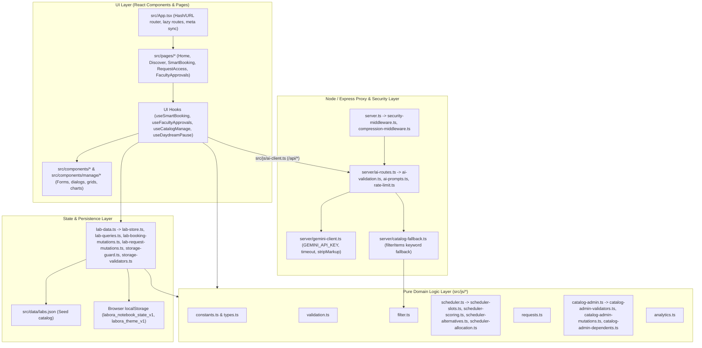

# Architecture — LABORA (LabLink)

**LABORA** separates browser UI rendering, pure deterministic domain logic, browser persistence, and server-side AI proxying into isolated layers so every scheduling rule, approval workflow, and catalog mutation can be tested offline without a browser, database, or API key.

---

## 1. Layered Module Diagram

---

## 2. Data Flow: UI to Logic to Storage / API

1. **Initial Hydration (`localStorage` -> `storage-guard.ts` -> `lab-store.ts`)**:
   - On startup, `lab-store.ts` reads `labora_notebook_state_v1` from `localStorage` (falling back safely to an in-memory copy when storage is unavailable).
   - `storage-guard.ts` and `storage-validators.ts` (`validatePersistedState`) verify every array, enum (`ACCESS_LEVELS`, `REQUEST_STATUSES`, `EQUIPMENT_TYPES`, `AVAILABILITY_STATUSES`), ISO date, byte size cap, and foreign-key reference (`departmentId`, `labId`, `itemId`). Corrupted or tampered payloads are discarded and reset cleanly to `src/data/labs.json`.
2. **User Interaction (`Pages` -> `Hooks` -> `Pure Logic` -> `lab-store.ts`)**:
   - Pages compose presentational components (`src/components/*`) and delegate stateful workflows to focused hooks (`useSmartBooking`, `useFacultyApprovals`, `useCatalogManage`).
   - User actions call store mutation wrappers (`bookSlot`, `releaseSlot`, `submitAccessRequest`, `transitionAccessRequest`, `reviewAccessRequest`, `adminAdd*`/`adminEdit*`/`adminDelete*`), which execute pure validation and state machines (`scheduler.ts`, `requests.ts`, `catalog-admin.ts`), persist updates with a `150 ms` debounce (`flushPendingSaves` on `pagehide`/`visibilitychange`), and notify React subscribers via `useSyncExternalStore`.
3. **AI Assistance (`DiscoverPage` / `SmartBookingPage` -> `ai-client.ts` -> `server/ai-routes.ts`)**:
   - Client requests hit `/api/suggest-equipment` or `/api/explain-allocation` over same-origin JSON (`5 KB` cap, `10 req/min` per IP).
   - If `GEMINI_API_KEY` is configured and responds within `10 s` with catalog-valid sanitized JSON, the AI response is returned (`source: "ai"`). Otherwise `ai-routes.ts` falls back seamlessly to deterministic keyword search (`suggestEquipmentFallback`) or deterministic rule explanation (`explainAllocation`) with `source: "fallback"`.

---

## 3. Folder & File Responsibilities

| Path | Responsibility |
|---|---|
| `server.ts`, `server/` | Express entry point, CSP/security headers (`security-middleware.ts`), Brotli/Gzip compression (`compression-middleware.ts`), `/api/*` validation & rate limiting (`ai-routes.ts`, `ai-validation.ts`, `rate-limit.ts`), Gemini wrapper (`gemini-client.ts`, `ai-prompts.ts`), and keyword fallback (`catalog-fallback.ts`). |
| `src/js/constants.ts`, `types.ts`, `validation.ts` | Single source of truth for domain constants (`LAB_SCHEDULE`, `ALLOCATION_WEIGHTS`, `LIMITS`, `CATALOG_LIMITS`, role/status enums), TypeScript models, and text/date/range normalization helpers. |
| `src/js/filter.ts`, `url-state.ts` | Case-insensitive catalog search, multi-filter intersection, pagination (`CATALOG_PAGE_SIZE`), and sanitized URL/hash parsing (`parseHashState`, `parseUrlState`, `serializeHashState`). |
| `src/js/scheduler*.ts` | Booking rules (`09:00–17:00` Mon–Sat, 1–4h, no overlaps, access gating via `canUserBookItem`), conflict grouping (`detectConflicts`), 0–100 priority scoring (`scoreRequest`), deterministic allocation (`allocate`), and plain-language summaries (`explainAllocation`). |
| `src/js/requests.ts`, `request-validation.ts` | Access request form validation (`validateRequest`), role-guarded state machine (`transitionRequest`), and deterministic faculty approval helper (`buildFacultySuggestion`). |
| `src/js/catalog-admin*.ts` | Role-guarded CRUD validators and immutable state transitions for subjects/departments, labs, equipment items, 1-hour slots, and dependency-safe deletion (`getDependents`, `cancelAffected`). |
| `src/js/analytics.ts`, `home-stats.ts` | Lab utilization percentages, underused item ranking, and dashboard summary metrics. |
| `src/js/lab-*.ts`, `storage-*.ts` | External store subscription (`useSyncExternalStore`), storage hydration/validation, debounced persistence, queries, and booking/request/catalog mutations. |
| `src/js/use-*.ts`, `page-meta.ts`, `theme.ts`, `ai-client.ts` | Route metadata/breadcrumbs, light/dark theme storage, AI API client wrappers, and React workflow/accessibility hooks (`useDialogFocusTrap`, `useDaydreamPause`, `useSmartBooking`, `useFacultyApprovals`). |
| `src/components/`, `src/components/manage/` | Presentational UI components (header, lab index sidebar, footer, cards, dialogs, schedule grid, conflict panel, multi-select, approval cards, utilization sidebar, catalog management tabs/modals). |
| `src/pages/` | Top-level route views (`HomePage`, `DiscoverPage`, `SmartBookingPage`, `RequestAccessPage`, `FacultyApprovalsPage`) composing hooks and components. |
| `src/css/` | Design tokens (`tokens.css`), paper-notebook component styles (`pages.css`), and reduced-motion-aware daydream strip CSS (`daydream.css`). |
| `tests/` | Offline Node (`node:test`) test suite covering filtering, scheduling, requests, catalog admin, analytics, storage resilience, and AI route validation/fallbacks. |

---

## 4. Key Design Decision: Deterministic Rules Decide, AI Only Suggests or Explains

1. **Zero LLM authority over bookings or approvals**: Eligibility (`canUserBookItem`), slot conflict detection (`detectConflicts`), priority ranking (`scoreRequest`), tie-breaking (`submittedAt`, then `id`), slot assignment (`allocate`), and status transitions (`transitionRequest`) run 100% locally in deterministic TypeScript with explicit weights (`35` deadline urgency, `25` feasibility, `20` student requirements, `20` usage fairness).
2. **AI strictly augments comprehension and discovery**: Gemini is constrained to two read-only helper roles—mapping free-text project descriptions onto validated existing catalog `itemId`s (`/api/suggest-equipment`) and summarizing an already-computed `AllocationResult` in plain language (`/api/explain-allocation`). Off-catalog IDs, markup, or missing keys never block core workflows because deterministic fallbacks take over automatically.
3. **Consistent `{ ok, ... }` domain contracts**: Logic validators, request transitions, and catalog mutations return structured results (`{ ok, error }`, `{ ok, fieldErrors }`, or `{ ok, request }`) instead of throwing or silently swallowing errors.
